# ku94run-monthly AI Context & System State

> 이 파일은 AI 코딩 어시스턴트가 `ku94run-monthly` 프로젝트의 시스템 상태, 2단계 파이프라인, Cloudflare D1 연동, 스케줄링 방식을 즉시 파악하도록 돕는 컨텍스트 문서입니다.

---

## 1. 프로젝트 개요 & 목적
- **목적**: 고려대학교 94학번 러닝 크루(KU94Run)의 월간 Garmin 러닝 챌린지 기록을 수집하고, Google Gemini API로 개인별 맞춤 러닝 코칭과 순위 분석을 생성하여 웹 리포트 및 카카오톡 메시지로 발송.
- **최종 메시지 수신 목표**: **매일 아침 08:00 정각 (한국 표준시 KST)**

---

## 2. 2단계 파이프라인 아키텍처 (★핵심)

```mermaid
flowchart TD
    subgraph 1단계["[1단계] 최신 가민 기록 수집 & 웹 리포트 배포 (06:50 ~ 23:50 KST 매시간 50분)"]
        A1["Cloud Scheduler / Actions (50 6-23 * * *)"] -->|활동시간 1시간 간격| A2["runteller_cron.yml"]
        A2 --> A3["garmin_client.py: Garmin Connect API 챌린지 수집"]
        A3 --> A4["gemini_coach.py: Gemini 3.8 Flash 코칭 생성"]
        A4 --> A5["report_page.py: HTML 및 site/kakao_delivery.json 생성"]
        A5 --> A6["GitHub Pages 자동 배포 완료"]
    end

    subgraph 2단계["[2단계] 멤버 카카오톡 코칭 메시지 발송 (매일 08:00 KST)"]
        B1["Cloud Scheduler (0 8 * * *)"] -->|정시 호출| B2["kakao_coaching_message.yml"]
        B2 --> B3["Pages에서 최신 kakao_delivery.json 다운로드"]
        B3 --> B4["Cloudflare Worker (run-teller-kakao-auth)에서 멤버 토큰 조회"]
        B4 --> B5["send_kakao_message.py: 멤버별 카카오톡 띵동! 발송"]
        B5 --> B6["배달 이력 Worker D1 저장 (internal/deliveries)"]
    end
```

### 왜 2단계로 나뉘어 있는가?
- **1단계 (가민 수집 & 리포트 최신화)**: 활동 시간대인 **06:50 ~ 23:50 매시간 50분**(`50 6-23 * * *`)마다 가민 서버에서 최신 순위를 수집하여 웹 대시보드(GitHub Pages)를 항상 최신 상태로 유지합니다. (수면 시간인 00:00~06:40 제외)
- **2단계 (카카오톡 발송)**: 매시간 카톡을 보내면 스팸이 되므로, 카톡 메시지는 **매일 아침 08:00 정각(`0 8 * * *`)에 단 1회** 최신 리포트를 발송합니다.
- 07:50에 수집된 따끈따끈한 최신 데이터가 08:00 카톡 발송 시 사용되므로 타이밍이 완벽하게 맞물립니다.

---

## 3. Cloudflare Worker 및 D1 토큰 연동 구조
- **Worker 엔드포인트**: `https://run-teller-kakao-auth.jinug-kim.workers.dev`
- **Cloudflare D1 데이터베이스**: `run-teller-kakao` (`TOKENS_DB`)
- **역할**:
  - `GET /internal/tokens`: 멤버별 최신 카카오 refresh token 조회
  - `POST /internal/deliveries`: 카카오 메시지 전송 성공/실패 이력 로깅
  - **장애 복원력 (Resilience Fallback)**: Cloudflare D1 일일 한도 초과(code 7500) 등으로 이력 서버가 500 에러를 반환하더라도, 카카오톡 메시지 발송 자체는 차단되지 않고 정상 전송되도록 예외 처리되어 있음.
- 중앙 `courier` 프로젝트와 유사한 형태이나, `ku94run-monthly` 전용으로 독립 구축된 Worker/D1을 사용함.

---

## 4. Google Cloud Scheduler 설정 명세

| 작업명 | 실행 주기 (KST) | 대상 URL (workflow_dispatch) | 역할 |
| :--- | :--- | :--- | :--- |
| `ku94run-1-collect` | `50 6-23 * * *` (06:50~23:50 매시간) | `.../actions/workflows/runteller_cron.yml/dispatches` | **가민 1시간 간격 수집 & Pages 최신화** |
| `ku94run-2-send` | `0 8 * * *` (08:00) | `.../actions/workflows/kakao_coaching_message.yml/dispatches` | **아침 8시 카톡 코칭 발송 (일 1회)** |

---

## 5. 핵심 파일 및 역할
- `main.py`: 1단계 가민 데이터 수집, 챌린지 분석, AI 코칭 생성, Pages 빌드 진입점
- `send_kakao_message.py`: 2단계 Cloudflare Worker 연동 및 카카오톡 템플릿 메시지 발송
- `garmin_client.py`: Garmin Connect OAuth 세션 복원 및 리더보드 수집
- `gemini_coach.py`: Gemini 3.8 Flash 기반 러너별 동기부여 및 훈련 코칭 생성
- `report_page.py`: 정적 HTML 웹 리포트 및 `kakao_delivery.json` 빌드
- `cloudflare/kakao-worker/`: 토큰 동기화 및 발송 이력 Cloudflare Worker 소스
