# ku94run-monthly AI Context & System State

> 이 파일은 AI 코딩 어시스턴트가 `ku94run-monthly` 프로젝트의 시스템 상태, 2단계 파이프라인, Cloudflare D1 연동, 스케줄링 방식을 즉시 파악하도록 돕는 컨텍스트 문서입니다.

---

## 1. 프로젝트 개요 & 목적
- **목적**: 고려대학교 94학번 러닝 크루(KU94Run)의 월간 Garmin 러닝 챌린지 기록을 수집하고, Google Gemini API로 개인별 맞춤 러닝 코칭과 순위 분석을 생성하여 웹 리포트 및 카카오톡 메시지로 발송.
- **최종 메시지 수신 목표**: **매일 아침 08:00 정각 (한국 표준시 KST)**

---

## 2. 2단계 파이프라인 아키텍처 (★핵심)

```mermaid
flowchart TD
    subgraph 1단계["[1단계] 최신 가민 기록 수집 & 웹 리포트 배포 (06:50 ~ 23:50 KST 매시간 50분)"]
        A1["Cloud Scheduler / Actions (50 6-23 * * *)"] -->|활동시간 1시간 간격| A2["runteller_cron.yml"]
        A2 --> A3["garmin_client.py: Garmin Connect API 챌린지 수집"]
        A3 --> A4["gemini_coach.py: Gemini 3.8 Flash 코칭 생성"]
        A4 --> A5["report_page.py: HTML 및 site/kakao_delivery.json 생성"]
        A5 --> A6["GitHub Pages 자동 배포 완료"]
    end

    subgraph 2단계["[2단계] 멤버 카카오톡 코칭 메시지 발송 (매일 08:00 KST)"]
        B1["Cloud Scheduler (0 8 * * *)"] -->|정시 호출| B2["kakao_coaching_message.yml"]
        B2 --> B3["Pages에서 최신 kakao_delivery.json 다운로드"]
        B3 --> B4["Cloudflare Worker (run-teller-kakao-auth)에서 멤버 토큰 조회"]
        B4 --> B5["send_kakao_message.py: 멤버별 카카오톡 띵동! 발송"]
        B5 --> B6["배달 이력 Worker D1 저장 (internal/deliveries)"]
    end
```



### 왜 2단계로 나뉘어 있는가?
- **1단계 (가민 수집 & 리포트 최신화)**: 활동 시간대인 **06:50 ~ 23:50 매시간 50분**(`50 6-23 * * *`)마다 가민 서버에서 최신 순위를 수집하여 웹 대시보드(GitHub Pages)를 항상 최신 상태로 유지합니다. (수면 시간인 00:00~06:40 제외)
- **2단계 (카카오톡 발송)**: 매시간 카톡을 보내면 스팸이 되므로, 카톡 메시지는 **매일 아침 08:00 정각(`0 8 * * *`)에 단 1회** 최신 리포트를 발송합니다.
- 07:50에 수집된 따끈따끈한 최신 데이터가 08:00 카톡 발송 시 사용되므로 타이밍이 완벽하게 맞물립니다.

---

## 3. Cloudflare Worker 및 D1 토큰 연동 구조
- **Worker 엔드포인트**: `https://run-teller-kakao-auth.jinug-kim.workers.dev`
- **Cloudflare D1 데이터베이스**: `run-teller-kakao` (`TOKENS_DB`)
- **역할**:
  - `GET /internal/tokens`: 멤버별 최신 카카오 refresh token 조회
  - `POST /internal/deliveries`: 카카오 메시지 전송 성공/실패 이력 로깅
  - **장애 복원력 (Resilience Fallback)**: Cloudflare D1 일일 한도 초과(code 7500) 등으로 이력 서버가 500 에러를 반환하더라도, 카카오톡 메시지 발송 자체는 차단되지 않고 정상 전송되도록 예외 처리되어 있음.
- 중앙 `courier` 프로젝트와 유사한 형태이나, `ku94run-monthly` 전용으로 독립 구축된 Worker/D1을 사용함.

---

## 4. Google Cloud Scheduler 설정 명세

| 작업명 | 실행 주기 (KST) | 대상 URL (workflow_dispatch) | 역할 |
| :--- | :--- | :--- | :--- |
| `ku94run-1-collect` | `50 6-23 * * *`, `5 0 * * *` (00:05 자정직후 & 06:50~23:50 매시간) | `.../actions/workflows/runteller_cron.yml/dispatches` | **가민 수집 & Pages 최신화 & 연말/월초 즉시 왕중왕 확정** |
| `ku94run-2-send` | `0 8 * * *` (08:00) | `.../actions/workflows/kakao_coaching_message.yml/dispatches` | **아침 8시 카톡 코칭 발송 (일 1회)** |

---

## 5. 가민 챌린지 자동 탐색 (Auto-Discovery) 메커니즘
- **목적**: 매달 호스트가 새 챌린지를 생성하고 사용자가 '참여(Join)'했을 때, GitHub Secrets나 YAML 파일을 수동으로 업데이트하지 않아도 런타임에 자동 인식.
- **동작 방식**:
  1. `garmin_client.py`: `discover_crew_challenge()`가 가민의 `get_active_adhoc_challenges()` 및 `/adhocchallenge-service/adHocChallenge/inProgress`를 조회.
  2. 키워드(`ku94`, `94`, `고려`)와 이번 달 날짜 범위를 검사하여 이번 달 챌린지 UUID를 자동 취득.
  3. `challenge_registry.py`: `upsert_active_challenge()`가 `data/challenges/{year}.yaml`에 새 챌린지를 자동 등록(`status: active`, `garmin_uuid: <UUID>`)하고 지난달은 `status: archived`로 자동 보관.
  4. GitHub Actions가 변경된 `data/challenges`를 자동으로 커밋하여 영구 보존.
  5. 월초 아직 챌린지가 열리지 않았거나 참여 전인 경우, 파이프라인 에러 없이 안내 로그를 남기고 안전하게 대기.

---

## 6. 성능 및 토큰 최적화 (Smart Fingerprint Caching)
- **배경**: 1시간 간격 수집 시 하루 18회 실행되나, 대부분의 시간대에는 러너들의 누적 거리가 변동되지 않음.
- **최적화 기법**:
  1. **지문 기반 스마트 캐싱 (`data/coaching_cache.json`)**:
     - 전체 참가자의 순위·거리 데이터를 SHA-256 해시로 지문(`fingerprint`)화.
     - 당일 아침 카톡 전송 직전(07:50)이거나 실제 누군가 뛰어 순위/거리가 변경되었을 때만 Gemini API 호출.
     - 기록 변동이 없는 시간대에는 직전 코칭 리포트를 즉시 재사용하여 **Gemini API 호출 및 토큰을 80% 이상 절감(0 tokens)**.
  2. **Gemini 생성 파라미터 제약**:
     - `max_output_tokens=300`, `temperature=0.7`로 고정하여 비용 상한 보장 및 응답 속도 최적화.
  3. **가민 OAuth 세션 즉시 덤프**:
     - 세션 복원 성공 시에도 최신 토큰을 `client.garth.dump()`하여 Actions 캐시 만료 및 SSO 재인증 방지.

---

## 7. 개인 정보 분리 및 모바일 다크 모드 (Privacy & Mobile Dark Mode UX)
- **개인 맞춤 지표 및 AI 코칭 (카카오톡 전용)**:
  - 개인별 현재 순위, 누적 거리, 일일 권장 거리, 남은 거리 및 Gemini AI 전략 코칭은 크루 공개 웹 리포트에서 제거하고 **개인 카카오톡 메시지("나와의 채팅")로만 프라이빗하게 발송**.
- **크루 전체 현황 배너 (Crew Summary Banner)**:
  - 공개 웹 상단에 개인 정보 없이 크루 전체 지표 [함께 달린 거리, 참여 러너, 공통 목표 완주자, 1인 평균 거리, 남은 기간(D-day)]를 모바일 2x2 반응형 카드로 렌더링.
- **연간 왕중왕 명예의 전당 포디움 & 마일스톤 (Hall of Fame Podium)**:
  - Consistency Champion 섹션에 1위(👑 챔피언), 2위(🥈), 3위(🥉) 시각적 포디움 카드 및 연간 크루 총합 마일스톤(총 누적 거리, 서울-부산 왕복 환산, 연간 완주 누적) 자동 집계 표시.
- **공개 웹 리포트 (크루 전체 공유)**:
  - 당월 진행 중인 챌린지 및 지난달 결과 아카이브, 전체 순위 및 달성 뱃지(토끼/슈퍼토끼), 연간 Consistency Champion 누적 랭킹 및 인터랙티브 차트 렌더링.
- **다크 모드 시스템**:
  - 스마트폰 OS 테마(`prefers-color-scheme: dark`) 자동 반영 (FOUC 방지 인라인 스크립트 적용).
  - 상단 헤더 원터치 토글 버튼 (🌙 다크 / ☀️ 라이트) 및 `localStorage` 영구 보존.
  - 고려대 크림슨 아이덴티티와 조화되는 딥 차콜/크림슨 다크 팔레트 (`--bg: #121013`, `--crimson: #ff5e84`).
  - 모바일 터치 스크롤 스냅, 가로 스크롤 테이블 가이드 및 SVG 차트 다크모드 반전 적용.

---

## 8. [차기 마이그레이션 계획] Cloudflare Worker/D1 ➔ GCP (Cloud Run + Firestore)

### 1) 마이그레이션 배경 & 필요성
- **문제점**: Cloudflare D1 무료 티어의 계정 전체 일일 500만 Row 읽기 한도로 인해, 다른 프로젝트 사용량 급증 시 카카오톡 토큰 조회 및 발송이 차단되는 500 에러(code 7500) 발생 위험이 있음.
- **해결책**: `riro2notion`에서 검증된 **GCP Cloud Run (서울 리전 `asia-northeast3`) + Google Cloud Firestore**로 이전하여 플랫폼을 단일화하고 DB 한도 문제를 영구 해소.
  - Firestore 무료 티어(하루 5만 회 읽기)는 크루 규모 대비 1,000배 이상 여유로움.
  - 팀원들에게 재로그인을 요청하지 않고 기존 토큰을 투명하게 이전(Zero-downtime Token Import) 가능.

### 2) 단계별 실행 가이드 (공수 약 30분)
1. **[1단계] 기존 토큰 백업**:
   ```bash
   curl -s -H "Authorization: Bearer <KAKAO_SYNC_TOKEN>" \
     "https://run-teller-kakao-auth.jinug-kim.workers.dev/internal/tokens" > kakao_tokens_backup.json
   ```
2. **[2단계] FastAPI + Firestore 인증 서버 작성**:
   - `cloudflare/kakao-worker/src/index.js`의 219줄 로직을 Python FastAPI (`server.py`)로 1:1 변환.
   - 컬렉션 구조: `members/{member_id}` (`refresh_token`, `updated_at`), `invitations/{token_hash}`, `kakao_deliveries/{date}_{member}`.
   - 공식 SDK: `google-cloud-firestore`.
3. **[3단계] Cloud Run 배포**:
   ```bash
   gcloud run deploy run-teller-kakao-auth \
     --source . \
     --region asia-northeast3 \
     --allow-unauthenticated \
     --set-env-vars "KAKAO_REST_API_KEY=...,KAKAO_CLIENT_SECRET=...,SYNC_TOKEN=...,ADMIN_TOKEN=..."
   ```
4. **[4단계] 기존 토큰 일괄 복원**:
   - `/admin/import` 엔드포인트에 `kakao_tokens_backup.json`을 POST하여 팀원 재로그인 없이 즉시 활성화.
5. **[5단계] 환경변수 & 카카오 콘솔 변경**:
   - 카카오 개발자 콘솔 > 플랫폼 > Redirect URI에 `https://<새CloudRun주소>/oauth/callback` 등록.
   - GitHub Actions Repository Secret/Variable `KAKAO_SYNC_URL`을 새 Cloud Run 주소로 변경.

---

## 9. 핵심 파일 및 역할
- `main.py`: 1단계 가민 데이터 수집, 챌린지 자동 탐색, 스마트 캐싱 기반 AI 코칭 생성, Pages 빌드 진입점
- `send_kakao_message.py`: 2단계 Cloudflare Worker 연동 및 카카오톡 템플릿 메시지 발송
- `garmin_client.py`: Garmin Connect OAuth 세션 복원(토큰 즉시 덤프), 활성 챌린지 자동 탐색, 리더보드 수집
- `challenge_registry.py`: 연간 챌린지 목록 관리, 챌린지 자동 업서트 및 아카이빙
- `gemini_coach.py`: Gemini 3.8 Flash 기반 러너별 동기부여 및 스마트 캐싱 코칭 생성 (`generate_with_cache`)
- `report_page.py`: 모바일 최적화 및 다크 모드가 내장된 반응형 웹 리포트 및 `kakao_delivery.json` 빌드
- `archive_pages.py`: 연도별/월별 아카이브 및 Consistency Champion 차트 생성
- `cloudflare/kakao-worker/`: 토큰 동기화 및 발송 이력 Cloudflare Worker 소스 (향후 GCP 이전 대상)
